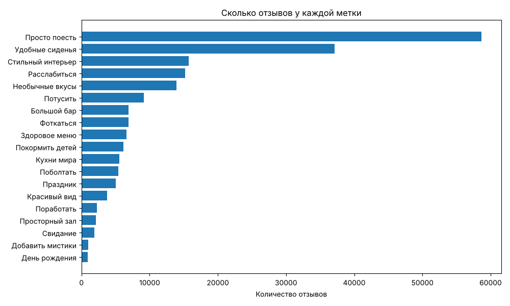
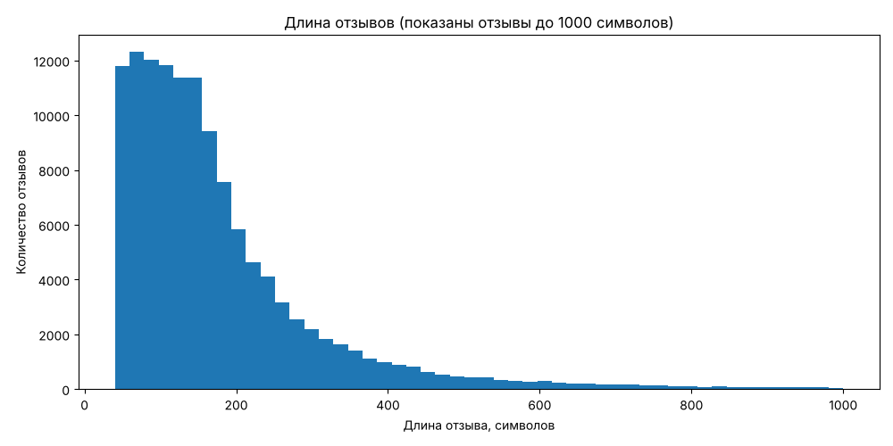

# 2gis: подготовка данных для классификации отзывов

Учебный проект студентов 2 курса по кейсу 2ГИС.

**Задача кейса:** по тексту отзыва о кафе или ресторане определить, какие из 19 характеристик к нему подходят. Например, «Свидание», «Покормить детей», «Красивый вид». У одного отзыва может быть сразу несколько характеристик (это называется multi-label классификация).

**Что лежит в этом репозитории:** часть работы дата-инженера. Мы берём исходный JSON, превращаем его в удобную таблицу, смотрим на данные, чистим их и делим на обучающую и тестовую выборки. Обучение модели делает ML-инженер команды.

## Исходные данные

Файл `task_2_vibes.json` (около 100 МБ) выдан организаторами кейса. В репозиторий он не добавляется: он слишком большой, а папка `data/` указана в `.gitignore`.

Внутри файла лежит список из 18 053 заведений. У каждого заведения есть id, название, рейтинг и метки. Метки устроены так: «метка → текст отзыва → фразы, из-за которых поставили метку». Один и тот же отзыв может стоять под несколькими метками.

## Как запустить

1. Положите `task_2_vibes.json` в папку `data/`.
2. Установите библиотеки:
   ```
   pip install -r requirements.txt
   ```
3. Запустите скрипты по порядку:
   ```
   python step1_look.py
   python step2_table.py
   python step3_stats.py
   python step4_clean.py
   python step5_split.py
   ```

## Что делает каждый шаг

| Скрипт | Что делает | Что получается |
|---|---|---|
| `step1_look.py` | Открывает JSON, показывает одно заведение, считает метки | Только вывод в консоль |
| `step2_table.py` | Переворачивает данные: одна строка = один отзыв, 19 колонок меток (0 или 1) | `data/reviews.csv` |
| `step3_stats.py` | Считает частоту меток, число меток на отзыв, длину текстов, рисует графики | `images/*.png` |
| `step4_clean.py` | Проверяет пропуски, убирает повторяющиеся тексты | `data/reviews_clean.csv` |
| `step5_split.py` | Случайно делит таблицу на train и test (80/20) | `data/train.csv`, `data/test.csv` |

## Результат

| Файл | Строк |
|---|---|
| `data/train.csv` | 100 229 |
| `data/test.csv` | 25 057 |

Колонки в обоих файлах одинаковые:
- `branch_id`: id заведения;
- `text`: текст отзыва (это вход для модели);
- `rating`: рейтинг заведения;
- 19 колонок с названиями меток: 1, если метка есть у отзыва, и 0, если нет (это то, что модель должна предсказать).

## Что мы заметили в данных

- **Метки встречаются очень неравномерно.** «Просто поесть» есть у 47% отзывов, а «День рождения» и «Добавить мистики» меньше чем у 1%. Редкие метки модели будет труднее всего научиться угадывать.

  

- **У большинства отзывов 1–2 метки.** У 54% отзывов одна метка, у 33% две, больше пяти почти не бывает.
- **Отзывы короткие.** Обычно около 140 символов, самый короткий 40, самый длинный 7 657. Пустых текстов нет.

  

- **Есть повторы.** 107 текстов встречались у разных заведений по несколько раз, и у 67 из них метки в копиях отличались. Мы оставили только первую копию каждого текста и убрали 177 строк. Иначе один и тот же отзыв мог бы попасть и в train, и в test.
- **Разбиение воспроизводимое.** Используется `random_state=42`, поэтому у всей команды получаются одинаковые `train.csv` и `test.csv`. Общих текстов в train и test нет, а каждая метка тоже делится примерно 80/20.
